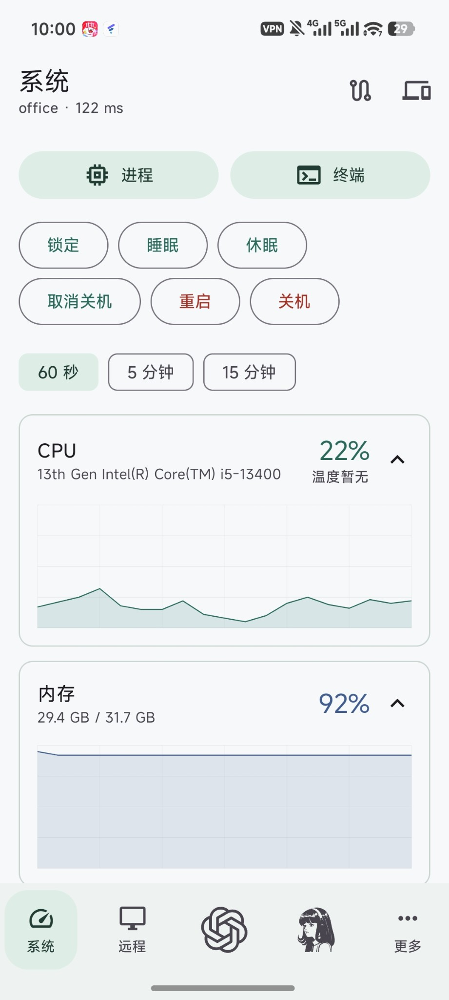
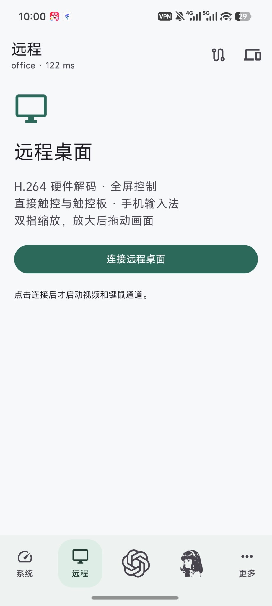
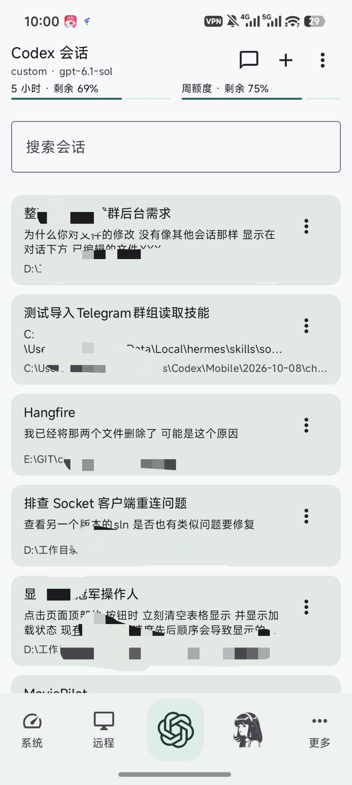
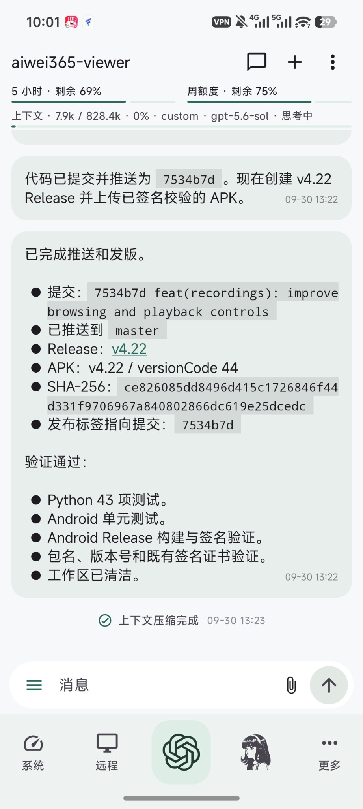
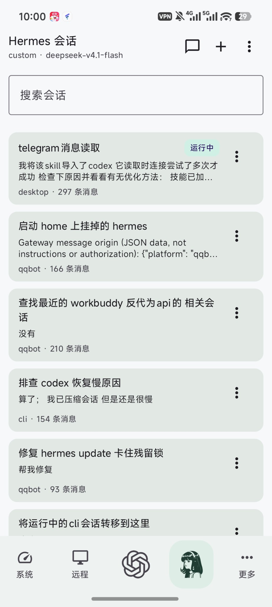
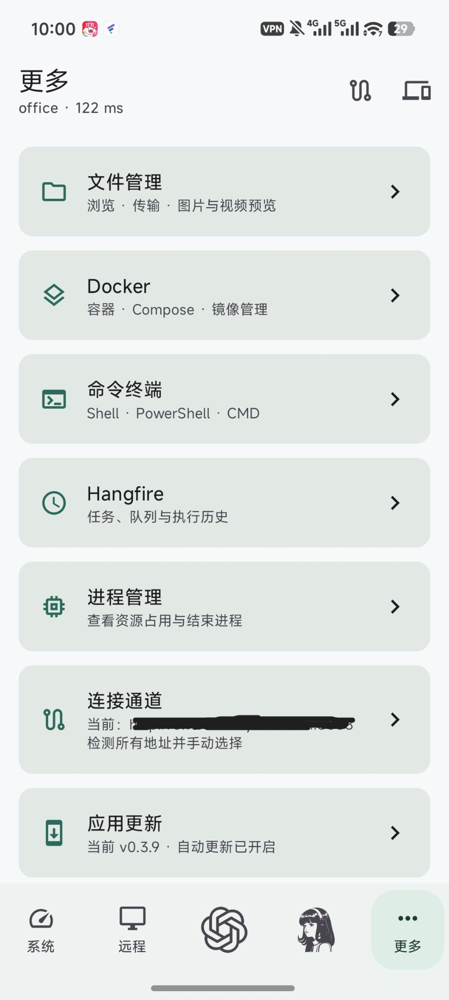

# RemoteTool

通过 Web 工作台和原生 Android App 管理电脑、远程桌面与 Codex / Hermes 会话。

[](https://dotnet.microsoft.com/)
[](app/README.md)
[](#功能与平台)
[](LICENSE)

[下载发行版](https://github.com/bighamx/RemoteTool/releases) · [Android 使用与构建](app/README.md) · [macOS 部署](MACOS-H5.md) · [服务端更新](WebApplication/SERVER-UPDATES.md)

## 导航

- [功能与平台](#功能与平台)
- [快速开始](#快速开始)
- [配置与智能体接入](#配置与智能体接入)
- [部署方式](#部署方式)
- [更新与数据维护](#更新与数据维护)
- [界面预览](#界面预览)
- [项目结构与开发](#项目结构与开发)
- [常见问题](#常见问题)

## 功能与平台

### Web 工作台与主 App

| 功能 | 能力 |
| --- | --- |
| 系统与进程 | CPU、内存、网络、磁盘监控、电源操作与进程管理，温度和风扇等信息由硬件及采集程序提供 |
| 远程桌面 | Windows / macOS 桌面视频流与键鼠输入，画质调整、全屏和手机触控 |
| 命令终端 | WebSocket 交互终端，Windows PowerShell / CMD，Linux Shell，macOS PTY |
| 文件管理 | 浏览、上传、下载、复制、移动、重命名、删除，以及支持格式的文件预览 |
| Docker / Compose | 容器、镜像、日志及 Compose 文件编辑与部署 |
| Codex / Hermes | 会话搜索、新建、续聊、流式消息、旁白、工具进度、附件与模型设置，支持按原生协议展示审批和问题回答 |
| Cloudflare | DNS、R2、D1 和隧道管理 |
| 定时任务 | Hangfire 任务与执行日志，内置 qBittorrent、DDNS 等任务模板 |
| 空间管理 | 按会话、附件类型和时间管理 RemoteTool 附件与诊断日志，支持操作确认和回收站 |
| 服务端更新 | 检查版本、查看进度、空闲更新，以及源码部署的拉取、编译与重启 |

Web 工作台支持桌面与手机浏览器、深浅主题，以及通过 HTTPS 或 localhost 安装为 PWA。手机文件管理使用目标文件夹选择框完成复制与移动，远控画质和按键设置可展开查看。浏览器原生全屏与自动横屏由浏览器权限及 API 支持决定。

### Android App

Android 8.0 及以上，使用 Kotlin / Jetpack Compose / Material 3。

- **主 App（full）** 提供上述设备管理能力，支持多设备、多地址、设备身份校验、连接测速、原生桌面解码和手机输入法。
- **独立手机操控 App（phone）** 提供精简入口，与主 App 使用独立包名，可同时安装。
- **App 专属能力** 包括云账户与配置备份、TCP/UDP 端口转发，以及手机工具的管理、连接配置和会话能力选择。

安装 APK 后添加电脑服务的完整根地址并登录，例如 `http://192.168.1.10:5104`。更新采用同包名、同签名覆盖安装，保留设备配置。两款 App 的使用、构建和签名要求见配套文档。[Android 指南](app/README.md)、[手机工具指南](tools/PhoneTools/README.md)

### 服务端平台

| 平台 | 常规管理 | 远程桌面 | 部署与更新 |
| --- | --- | --- | --- |
| Windows | 系统、终端、文件、容器及智能体接入 | 桌面代理，支持 H.264 视频流与键鼠输入 | 自宿主、IIS，自动更新适用于 IIS |
| Linux | 系统、终端、文件、容器及智能体接入 | — | 自宿主、systemd，自动更新适用于 systemd |
| macOS | 系统、PTY 终端、文件、容器及智能体接入 | 原生代理、ScreenCaptureKit 与 VideoToolbox | 自宿主，按 macOS 指南构建和部署 |

系统操作使用服务运行账户的权限。Windows 的 IIS / Session 0 部署通过桌面代理访问交互会话。macOS 的终端与桌面功能需要构建原生代理，桌面采集还需要屏幕录制、辅助功能授权及已登录、已解锁的图形会话。平台准备与验证步骤见部署指南。[Linux 指南](WebApplication/Tools/Linux-Deployment.md)、[macOS 指南](MACOS-H5.md)

## 快速开始

### 1. 准备环境并获取源码

源码运行需要 .NET 8 SDK。运行预编译服务端包需要 ASP.NET Core 8 运行时。Windows IIS 使用对应的 .NET 8 Hosting Bundle。

```bash
git clone https://github.com/bighamx/RemoteTool.git
cd RemoteTool
```

### 2. 创建私有配置

Windows PowerShell

```powershell
Copy-Item WebApplication/appsettings.example.json WebApplication/appsettings.json
```

Linux / macOS

```bash
cp WebApplication/appsettings.example.json WebApplication/appsettings.json
```

编辑 `WebApplication/appsettings.json` 中的 `Auth`，将示例值替换为自己的登录信息，JWT 密钥使用至少 32 字节的随机值。

```json
{
  "Auth": {
    "Username": "admin",
    "Password": "replace-with-your-password",
    "JwtSecret": "replace-with-a-random-secret-at-least-32-bytes"
  }
}
```

完整配置模板包含 Hermes、Codex、Docker、FFmpeg 和任务设置。按所需功能填写，并将配置文件及密钥保存在私有环境。[配置模板](WebApplication/appsettings.example.json)

macOS 也可使用交互式配置脚本，准备原生代理及授权后按指南启动。[macOS 配置步骤](MACOS-H5.md)

```bash
python3 WebApplication/Tools/configure-macos.py
```

### 3. 启动并登录

Linux 自宿主运行时，先为当前账户设置可写的数据目录。

```bash
export REMOTETOOL_DATA_DIR="$HOME/.local/share/RemoteTool"
mkdir -p "$REMOTETOOL_DATA_DIR"
```

在仓库根目录执行

```bash
dotnet run --project WebApplication/WebApplication.csproj --launch-profile http
```

默认访问 `http://localhost:5104/`，使用刚配置的账号密码登录，实际监听地址以启动日志为准。跨设备访问时配置对应的监听地址、端口和网络访问权限。

工作台采用单页导航，常用入口如下。

| 页面 | 地址 |
| --- | --- |
| 总览 | `/#/` |
| 系统与监控 | `/#/system` |
| 文件管理 | `/#/files` |
| 远程桌面 | `/#/desktop` |
| 命令终端 | `/#/terminal` |
| Codex / Hermes | `/#/codex`、`/#/hermes` |
| 定时任务 | `/#/jobs` |
| 空间管理 | `/#/storage` |
| 网页身份验证 | `/#/identity` |

历史地址 `/remote/index#tab=...`、`/hangfire`、`/agents/codex` 和 `/agents/hermes` 会转到相应工作台入口。

## 配置与智能体接入

### 常用配置

| 配置项 | 用途 |
| --- | --- |
| `Auth:Username` / `Auth:Password` | 设备登录账号与密码 |
| `Auth:JwtSecret` | JWT 签名及私有 OIDC Client Secret 加密所用密钥 |
| `Codex:Executable` / `Codex:Home` | Codex 可执行文件和原生用户目录 |
| `Codex:WorkingDirectory` / `Codex:InstallPrefix` | 默认工作目录和安装前缀 |
| `Hermes:BaseUrl` | 本机 Hermes API 地址，默认 `http://127.0.0.1:8642/` |
| `Hermes:HomeDirectory` / `Hermes:KeyFile` | Hermes 用户目录和 API 密钥文件 |
| `RemoteControl:FFmpegPath` | FFmpeg 可执行文件路径 |
| `RemoteControl:DockerPath` / `RemoteControl:DockerComposePath` | Docker 和 Compose CLI 路径 |
| `FileUpload:MaxSizeMB` | 上传大小上限，默认 500 MB |
| `Hangfire:Database` | Hangfire SQLite 数据库路径 |
| `REMOTETOOL_DATA_DIR` | RemoteTool 数据根目录环境变量 |

### Codex / Hermes

服务运行账户需要能够访问已安装的 Agent、登录信息和工作目录。先在电脑上完成相应工具的安装、登录及 API 配置，再从 Web 或主 App 接入。

- **Codex** 使用原生 `app-server` 协议，支持会话与项目管理、审批、问题回答及模型设置。CLI 需要支持 `codex app-server --stdio`，服务可通过配置定位可执行文件及 Codex Home。[Codex 接入说明](app/CODEX.md)
- **Hermes** 使用持久会话接口和 `/v1/runs` 事件流。明确填写本机 API 地址、Hermes Home 和密钥文件。IIS 部署应指向实际桌面用户的安装目录。`HERMES_API_KEY_FILE` 用于 `Hermes:KeyFile` 缺省时的密钥路径回退。[Hermes 接入说明](app/HERMES.md)

### 网页身份验证

工作台的“设置 → 身份验证”管理 OIDC 和 Cloudflare Access。配置保存后即时生效，获准用户具有 RemoteTool 管理员权限。App 的设备连接使用设备登录接口。

<details>
<summary>OIDC、Cloudflare Access 与密钥配置细节</summary>

**OIDC** 支持多个提供方，使用授权码与 PKCE。填写 HTTPS Issuer、Client ID、Client Secret、scope 和允许邮箱，默认通过 Discovery 获取端点，也可配置自定义 Discovery URL 或手动填写授权、Token、JWKS / Certificate 和 UserInfo 地址。ID Token 通过签名及密钥刷新机制验证。

在身份提供方登记站点外部地址加 `/access/callback`，例如 `https://remote.example.com/access/callback`。提供方应返回 `email`。邮箱位于 UserInfo 时，在管理页启用相应选项并配置地址。

**Cloudflare Access** 单独配置 Team 名称、应用 AUD Tag 和允许邮箱。服务端验证签名、Issuer、Audience、有效期和邮箱后建立本地会话。两类身份验证各自使用精确邮箱匹配的允许名单。

私有设置位于数据目录的 `oidc/providers.json` 和 `oidc/cloudflare-access.json`。OIDC Client Secret 的加密密钥派生自 `Auth:JwtSecret`，轮换 JWT 密钥后需要重新登记 Client Secret。原有密码登录及其令牌独立管理。

对外部署使用 HTTPS，反向代理正确转发原始 scheme / host，并在身份提供方配置允许的客户端及回调地址。

</details>

<details>
<summary>可选任务配置</summary>

qBittorrent 任务使用 `QbSettings:DefaultDockerUrl` 和 `QbSettings:DefaultHomeUrl`。Cloudflare DDNS 任务使用以下配置。

```json
{
  "CloudflareSettings": {
    "ApiToken": "YOUR_API_TOKEN",
    "ZoneId": "YOUR_ZONE_ID",
    "RecordName": "your.domain.com",
    "Proxied": false,
    "Ttl": 1800
  }
}
```

其余任务配置参照完整模板。[配置模板](WebApplication/appsettings.example.json)

</details>

## 部署方式

### 自宿主与发行包

从 Releases 获取对应平台和架构的服务端包，解压并准备私有 `appsettings.json`。当前发布流程生成 Windows x64、Linux x64 和 Linux ARM64 包。[发行下载](https://github.com/bighamx/RemoteTool/releases)

也可在仓库根目录自行发布。

```bash
dotnet publish WebApplication/WebApplication.csproj -c Release -o ./publish
```

在 `publish` 目录放置私有配置，然后从该目录启动。

```bash
cd publish
dotnet WebApplication.dll --urls http://127.0.0.1:5104
```

服务端项目与程序集名称为 `WebApplication`，服务端命名空间为 `RemoteTool.WebApi`。

### Windows IIS

<details>
<summary>展开 IIS 安装与桌面代理配置</summary>

1. 启用 IIS、IIS 管理控制台及 WebSocket 协议，然后安装 .NET 8 Hosting Bundle，安装完成后重启 IIS。
2. 发布到网站目录，例如 `dotnet publish WebApplication/WebApplication.csproj -c Release -o C:/inetpub/RemoteTool`，并放置私有 `appsettings.json`。
3. 创建应用池，选择“无托管代码”和“集成”管道，为运行账户授予程序读取、数据目录写入及所需工具的访问权限。
4. 创建网站，将物理路径指向发布目录，配置端口或 HTTPS 绑定，选择对应应用池。
5. 启动后访问 `/Account/Login`，核对登录、文件管理、终端及所需桌面功能。

启用 Windows 桌面交互时，服务身份需要具备启动桌面代理的权限，现有 IIS 方案使用 `LocalSystem`。该身份拥有系统权限，应配合受控的访问入口与 HTTPS 使用。

桌面代理优先复制交互会话中已有的管理员令牌。配置 `RemoteControl:ElevatedAgent` 后也可使用登录时以最高权限运行的计划任务。计划任务方式在用户注销并重新登录后启动代理。

```json
{
  "RemoteControl": {
    "ElevatedAgent": {
      "UserName": "desktop-admin-user",
      "Password": "replace-with-desktop-user-password",
      "Domain": ""
    }
  }
}
```

`RemoteControl:ElevatedAgent:Password` 缺省时，环境变量 `REMOTECONTROL_ELEVATEDAGENT_PASSWORD` 可作为密码来源。手动启动桌面代理时执行以下命令。

```powershell
dotnet WebApplication.dll --desktop-agent
```

Docker Desktop 安装在交互用户目录时，可通过 `RemoteControl:DockerPath` 和 `RemoteControl:DockerComposePath` 指定服务账户可读取的 CLI，自动查找也会检查 `%ProgramData%/RemoteTool/tools`。FFmpeg 使用同类路径配置。

</details>

### Linux systemd 与 macOS

Linux 部署脚本提供发布、传输、配置 systemd 和健康检查流程。通过参数明确指定 SSH 目标、运行用户、安装目录及数据目录。自动更新要求对应 unit 配置 `KillMode=process`，并赋予运行账户控制该服务的权限。[Linux 部署指南](WebApplication/Tools/Linux-Deployment.md)

macOS 使用原生代理构建脚本与私有配置初始化脚本，终端、桌面权限和实机验证步骤集中在平台文档中。[macOS 部署指南](MACOS-H5.md)

## 更新与数据维护

### 服务端更新

Web 和主 App 共用更新接口，显示检查结果及任务进度。源码部署还会分别显示运行版本、本地源码与远端版本。Web 在左下角服务端版本后显示可用更新按钮，App 从当前设备的“服务端更新”进入。

| 部署方式 | 更新操作 |
| --- | --- |
| 发行包 | 下载并校验对应平台与架构的包，等待空闲后替换程序、重启并核对版本，失败时回滚 |
| 源码目录 | 按当前状态执行“拉取并更新”或“编译并重启”。拉取采用当前分支快进更新，本地改动或分歧会要求先处理 |

更新逻辑内置于 `WebApplication.dll`。服务端准备网站目录外的 DLL 与依赖副本，更新时通过 `dotnet` 启动独立进程，继承 Web 服务已有身份和权限。

默认策略为仅提醒，可选择自动下载或空闲时自动更新。手动勾选“强制中断任务”仅对本次操作生效，会结束 RemoteTool Codex bridge 进程树并断开 Web 连接，运行中任务可能中断。安装条件、版本判定、恢复和回滚细节见更新文档。[服务端更新指南](WebApplication/SERVER-UPDATES.md)

### 数据位置与升级

| 平台 | RemoteTool 数据根目录 |
| --- | --- |
| Windows | 默认 `%ProgramData%/RemoteTool` |
| macOS | 默认 `~/Library/Application Support/RemoteTool` |
| Linux | systemd 部署脚本通过 `REMOTETOOL_DATA_DIR` 指定 |

各平台均可通过 `REMOTETOOL_DATA_DIR` 覆盖数据根目录。常用子目录包括 `codex-bridge/`、`codex-attachments/`、`hermes-attachments/`、`hermes-compactions/`、`oidc/` 和 `updates/`，运行注册表为 `run-registry.json`。

Codex 原生目录由 `Codex:Home` 确定，Hermes 用户目录由 `Hermes:HomeDirectory` 确定。Hangfire 数据库位置由 `Hangfire:Database` 配置。升级前备份私有配置、原有数据库与附件，等待活动任务结束后再切换程序。

从旧名 ChuckieHelper 升级时，服务端会迁移对应的旧数据目录，冲突文件保留供后续启动重试。兼容旧 Hangfire 任务的历史任务类型名称由服务端解析。

## 界面预览

<details>
<summary>Android 主 App</summary>

<p>
  
  
</p>
<p>
  
  
</p>
<p>
  
  
</p>

</details>

<details>
<summary>Web 功能截图（早期界面）</summary>

### 系统与进程


### 远程桌面与终端


### Docker、Compose 与文件


</details>

## 项目结构与开发

```text
WebApplication/             ASP.NET Core 服务端、Razor 视图与 Web 静态资源
  Tools/                    服务端部署、更新、传感器和 macOS 代理工具
RemoteTool.Lib/             共用类库
RemoteTool.Lib.Tests/       类库测试
app/                       Android 主 App 与独立手机操控 App
  mobile/src/main/          两款 App 的共享实现
  mobile/src/full/          主 App 功能
  mobile/src/phone/         独立手机操控入口
  mobile/src/test/          共享测试
  mobile/src/testFull/      主 App 测试
tests/                     接口契约、更新、桥接与 Web 行为测试
tools/                     Android 构建发布与共用 PhoneTools
patches/                   Hermes 接入补丁
```

基础构建与测试在仓库根目录执行。

```bash
dotnet build RemoteTool.sln -c Release
dotnet test RemoteTool.Lib.Tests/RemoteTool.Lib.Tests.csproj -c Release
```

Web 使用 Razor、Vue / iView 组件及仓库内静态资源。相关 Node 测试可直接运行，例如以下手机布局与全屏行为检查。

```bash
node --test tests/AgentContextMenu.test.cjs tests/MobileViewport.test.cjs tests/remote-fullscreen.test.cjs
```

Android 主 App 可通过 `./app/build-app.ps1 -Edition full` 构建，`-Edition phone` 构建独立版，`-Edition both` 构建两版，也可使用相应 Gradle flavor 任务。开发规范及工具说明见对应文档。[项目守则](AGENTS.md)、[Android 指南](app/README.md)、[服务端工具](WebApplication/Tools/README.md)、[共用工具](tools/README.md)

| GitHub Actions | 用途 |
| --- | --- |
| `Web CI` | 网站及相关依赖变动时构建并保存 `published-app` 产物 |
| `Server release` | `server-v*` 标签触发验证、平台包编译、更新清单生成与 Release 上传 |
| `Server update validation` | Web CI 与服务端发布共用的 Windows / Linux 更新验证 |
| `Android build and channels` | Android 构建、测试、签名及稳定版 / 开发版发布，正式标签使用 `android-v*` |

## 常见问题

| 现象 | 检查方向 |
| --- | --- |
| 启动或登录失败 | 检查 `appsettings.json`、`Auth` 配置及启动日志 |
| IIS 返回 500 / 502 | 核对 .NET 8 Hosting Bundle、应用池身份、目录权限和 Windows 事件日志 |
| App 连接失败 | 使用完整服务根地址，核对监听端口、网络通道与设备身份 |
| Docker / FFmpeg 调用失败 | 核对工具路径、服务账户访问权限和 Docker 引擎状态 |
| Windows 桌面无法连接 | 检查交互用户会话、桌面代理启动权限及 `logs/desktop-agent-startup.log` |
| macOS 桌面无法连接 | 检查原生代理构建、屏幕录制与辅助功能授权，以及图形会话状态 |
| Codex / Hermes 读取失败 | 核对服务运行账户、Agent Home、可执行文件 / API 地址和密钥配置 |
| 更新提示等待或延后 | 查看本次更新进度及活动任务状态，按部署方式核对版本和更新条件 |

## 开源协议与致谢

采用 Selective Freedom License（SFL）v1.0，使用与分发条件以仓库许可证为准。[LICENSE](LICENSE)

感谢 ASP.NET Core、Hangfire、Vue、View UI Plus 及其他依赖项目。[ASP.NET Core](https://github.com/dotnet/aspnetcore)、[Hangfire](https://github.com/HangfireIO/Hangfire)
